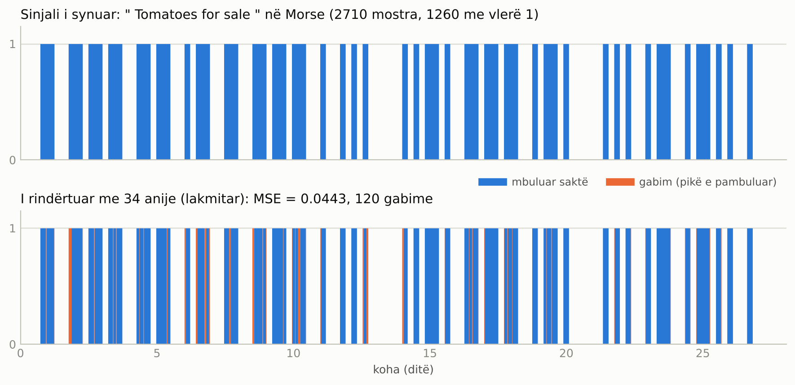
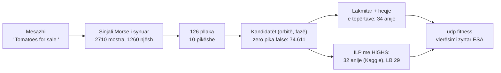
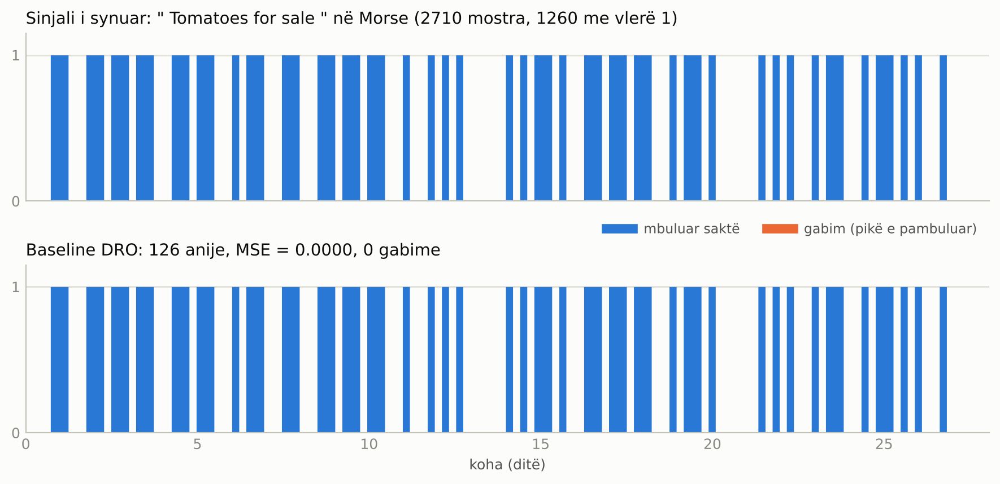
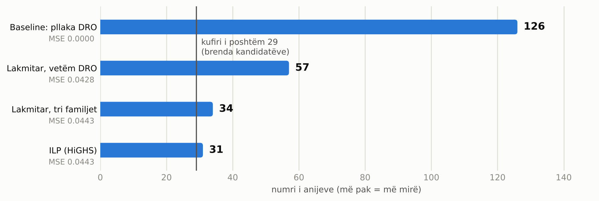
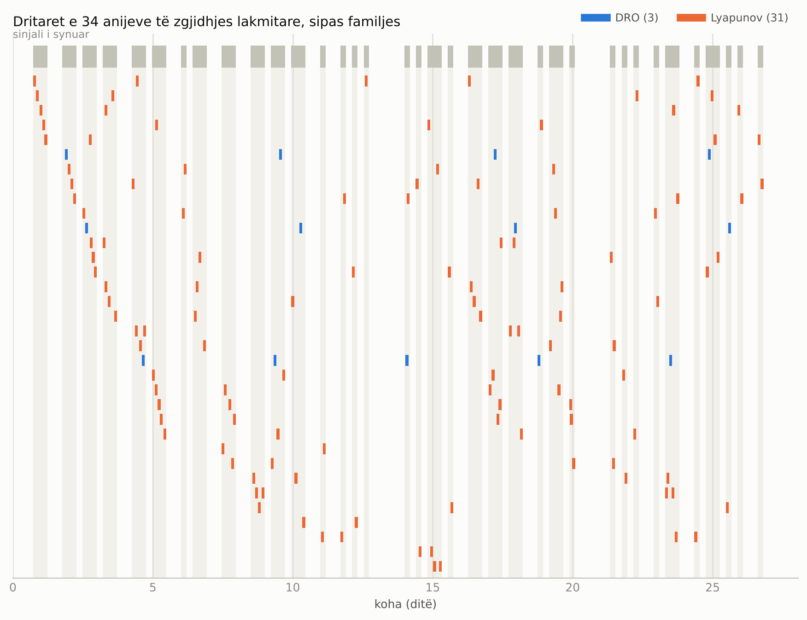
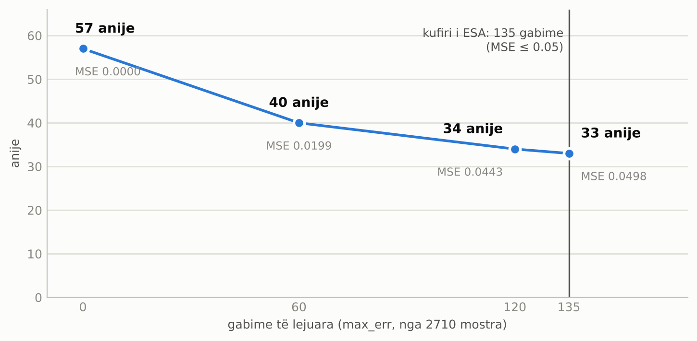
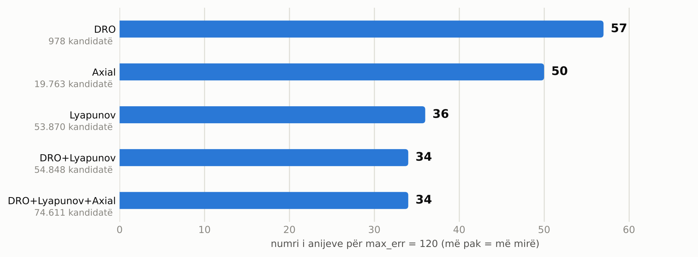
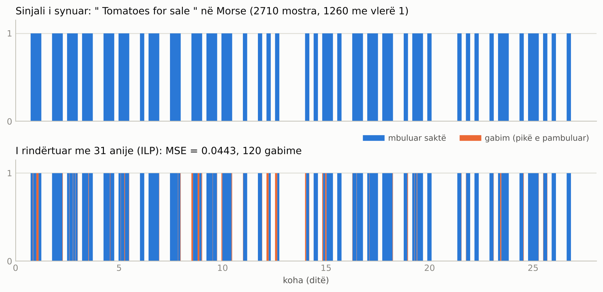
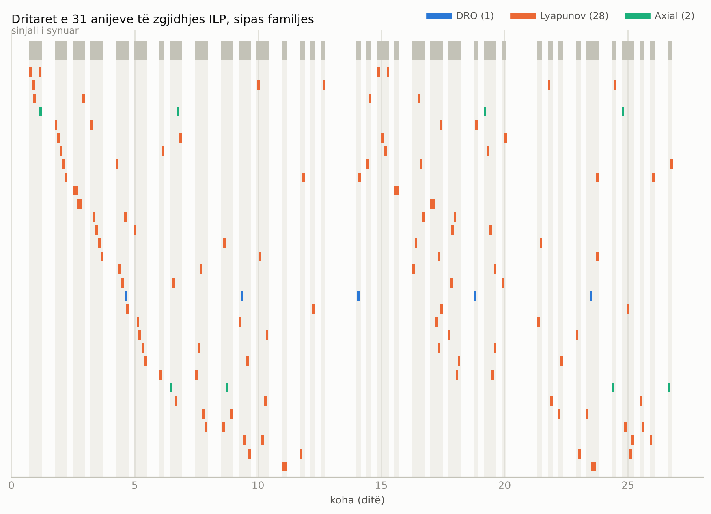

# Algorithmic Design and Analysis for Occultation-Based Signal Broadcasting (ESA SpOC 4)
# Luna Tomato Advertising — zgjedhja e flotës minimale të anijeve hapësinore për të transmetuar një mesazh Morse
Projekt semestral për lëndën Dizajni dhe Analiza e Algoritmeve (DAA), i bazuar në sfidën e Advanced Concepts Team (ACT) të ESA-s SpOC 4, Challenge 3 — Luna Tomato Advertising.
Çdo herë që një anije kalon para Hënës (nga këndvështrimi i Tokës), ajo errëson një pjesë të dritës dhe krijon një "dritare" okultimi. Detyra është të zgjidhen orbita dhe faza për një flotë anijesh të tilla, ashtu që dritaret e tyre së bashku të rindërtojnë sinjalin Morse të mesazhit " Tomatoes for sale ", me sa më pak anije, duke mbajtur gabimin mesatar katror (MSE) nën 0.05.

## Rezultati në një shikim

| Metoda | Anije | MSE | Statusi |
|---|---:|---:|---|
| Zgjidhje e rastësishme (`run_udp.py`, seed 42) | 1934 | 0.5351 | e pavlefshme |
| Baseline: një anije DRO për çdo pllakë 10-pikëshe | 126 | 0.0000 | e vlefshme |
| Lakmitar (greedy) + heqje e anijeve të tepërta | 34 | 0.0443 | e vlefshme |
| **ILP (HiGHS, 300 s) në Kaggle** | **32** | 0.0428 | **e vlefshme (vlerësuar me `udp.fitness` në Kaggle)** |
| ILP, ekzekutimi i dytë (Linux, 300 s) | 31 | 0.0443 | e vlefshme; ruhet te `solutions/ilp_x.npy` |
| Kufiri i poshtëm (relaksimi LP / HiGHS) | ≥ 29 | — | vlen vetëm brenda kandidatëve (shih [§7](#7-kufizime-dhe-vërejtje-të-ndershme)) |

Nga baseline-i (126) te rezultati i optimizimit në Kaggle (32 anije) flota zvogëlohet me rreth **75%**. Të gjitha zgjidhjet vlerësohen me `udp.fitness` të kodit zyrtar të ESA-s. Një ekzekutim i dytë i të njëjtit kod ILP, në një mjedis tjetër, gjeti 31 anije (HiGHS nuk është deterministik, shih [§5.4](#54-ilp-32-anije-në-kaggle-31-në-ekzekutimin-e-dytë)). Asnjëra nuk është minimum i provuar: kufiri i poshtëm është 29, pra mbetet një hendek prej 2 deri 3 anijesh.



## Përmbajtja

- [Si ta ekzekutoni](#si-ta-ekzekutoni)
1. [Përshkrimi i problemit](#1-përshkrimi-i-problemit)
2. [Modeli matematik](#2-modeli-matematik)
3. [Algoritmet](#3-algoritmet)
4. [Analiza e kompleksitetit](#4-analiza-e-kompleksitetit)
5. [Rezultatet](#5-rezultatet)
6. [Verifikimi dhe riprodhueshmëria](#6-verifikimi-dhe-riprodhueshmëria)
7. [Kufizime dhe vërejtje të ndershme](#7-kufizime-dhe-vërejtje-të-ndershme)
8. [Struktura e projektit](#8-struktura-e-projektit)
9. [Përfundimi](#9-përfundimi)
10. [Burime](#10-burime)

## Si ta ekzekutoni

Kodi zyrtar i ESA-s (`esa_code/lta_udp.py`) importon `heyoka`. Në **Windows** `pip install heyoka` dështon (kërkon kompilator), prandaj përdoret `conda`; në **Linux / Kaggle** `pip install heyoka` funksionon.

```bash
conda env create -f environment.yml      # krijon mjedisin "luna" (python 3.12, heyoka, numpy, scipy, matplotlib, pygmo)
conda activate luna
# nëse mjedisi "luna" ekziston që më parë:  conda install scipy

python run_udp.py                  # provë e parë: zgjidhje e rastësishme + koha e një fitness-i
python verifiko.py                 # vlerëson me udp.fitness çdo zgjidhje në solutions/
python baseline.py                 # baseline me pllaka DRO        -> 126 anije
python kerkimi.py                  # lakmitar + heqje              -> 34 anije
python eksperimente.py             # eksperimentet E1/E2           -> rezultatet_riprodhim.csv
python ilp_kerkimi.py 120 33 300   # ILP: tolerancë 120, kufi 33 anije, 300 s  (rreth 1–1.5 GB RAM)
python grafiket.py                 # figurat PNG (ruhen aty ku është README.md)
```

**Optimizimi i rëndë (kandidatët, eksperimentet, ILP) u ekzekutua në Kaggle**, sipas udhëzimit të profesorit; kompjuteri lokal përdoret për zhvillim dhe verifikim. Në një notebook Kaggle (me internet të aktivizuar) hapat janë: `pip install heyoka`, `git clone` i këtij repo-je, pastaj komandat e mësipërme. Kujdes: sesionet e Kaggle fshijnë skedarët kur mbyllen — ruani daljet me *Quick Save* dhe shkarkojini përpara se të mbyllni sesionin.

## 1. Përshkrimi i problemit

Jepet sinjali i synuar `y ∈ {0,1}^S` i mesazhit `" Tomatoes for sale "` në kodin Morse, i diskretizuar në **S = 2710 mostra** (0.01036 ditë secila), prej të cilave **1260 janë "1"**. Sinjali përbëhet nga **36 pulse**: 18 pika (20 mostra secila) dhe 18 viza (50 mostra secila). Gjerësia e një dritareje okultimi është **10 mostra (0.1036 ditë)**, pra sinjali ndahet saktësisht në **126 pllaka** 10-pikëshe (18·2 + 18·5 = 126).

Tri familje orbitash japin dritaret e mundshme:

| Familja | Orbita | Dritare për anije | Periudha (ditë): min / mediane / max |
|---|---:|:---:|---|
| DRO | 188 | 1 | 0.51 / 26.87 / 27.88 |
| Lyapunov | 291 | 2 | 11.78 / 25.26 / 32.91 |
| Axial | 300 | 2 | 17.30 / 17.86 / 18.15 |

Konvertimi i periudhës sipas sfidës: `period_days = period_rad / (2π) · synodic_period`, me `synodic_period = 27.8511` ditë. Gjithsej **N = 779 orbita**.

**Vektori i zgjidhjes** `x` ka gjatësi `N + 5N = 4674`:

- `sel = x[:N]` — numri i anijeve (0…5) në çdo orbitë; maksimumi **5 anije për orbitë**;
- `phs = x[N:]` — për çdo orbitë 5 faza në `[0, 2π)`; vetëm `sel[i]` të parat llogariten.

**Objektivi** (`udp.fitness`): zgjidhja është e vlefshme nëse `MSE ≤ 0.05`; mes të vlefshmeve fiton ajo me më pak anije. Meqë `135/2710 = 0.0498` dhe `136/2710 = 0.0502`, lejohen **më së shumti 135 mostra të gabuara**.

## 2. Modeli matematik

Një **anije** është një çift `(o, φ)`: orbita `o` dhe faza `φ`. Dritaret e saj sipas kodit zyrtar (koha në njësi pa dimension, `TU` = njësia e kohës e sistemit Tokë–Hënë):

- dritarja 1 (të gjitha familjet): qendra në `(2π − φ) / (2π·f₁)`, e përsëritur me periudhë `1/f₁`;
- dritarja 2 (vetëm Lyapunov/Axial): qendra në `(φ + π) / f₂`, e përsëritur me periudhë `1/f₂`.

Sinjali i rindërtuar dhe gabimi:

$$r = \mathrm{clip}\Big(\sum_{k \in \text{anije}} m_k,\ 0,\ 1\Big), \qquad \mathrm{MSE} = \frac{1}{S}\sum_{t=1}^{S}\,(r_t - y_t)^2$$

ku `m_k ∈ {0,1}^S` është maska e dritareve të anijes `k`. Dritaret që mbivendosen nuk penalizohen (shuma pritet në 1).

**Kandidatët pa pika false.** Një çift `(o, φ)` quhet *kandidat* nëse maska e tij nuk bie asnjëherë mbi një mostër ku `y = 0` (zero pika false) dhe mbulon të paktën 15 mostra me `y = 1`. Atëherë MSE zvogëlohet në `(mostra të pambuluara) / S`, dhe problemi bëhet **problem mbulimi**. Me `C` bashkësinë e kandidatëve, `P` pikat e synuara (`|P| = 1260`), `y_c ∈ {0,1}` zgjedhjen e kandidatit `c`, `s_p` gabimin në pikën `p` dhe `E` tolerancën:

$$\min \sum_{c \in C} y_c \quad \text{me kushtet} \quad \sum_{c \ni p} y_c + s_p \ge 1 \;\; (\forall p \in P), \qquad \sum_{p \in P} s_p \le E, \qquad \sum_{c \in o} y_c \le 5 \;\; (\forall o)$$

Ky është një **set cover i pjesshëm me kapacitet** (kufiri 5 anije/orbitë). Set cover i përgjithshëm është NP-i plotë (Karp, 1972); për këtë instancë konkrete nuk kemi dhënë provë formale të vështirësisë, prandaj e trajtojmë me një heuristikë lakmitare dhe me ILP.



## 3. Algoritmet

### 3.1 Baseline i rastësishëm — `run_udp.py`
Një `x` i tërhequr uniformisht nga kufijtë (seed 42) jep **1934 anije dhe MSE = 0.535**: i pavlefshëm. Shërben vetëm si pikë reference dhe për të matur kohën e një `fitness`-i.

### 3.2 Baseline me pllaka DRO — `baseline.py`
Çdo puls ndahet në pllaka 10-pikëshe (126 gjithsej). Për çdo pllakë gjenden orbitat DRO që, me një fazë të përshtatshme, vendosin dritaren pikërisht mbi të pa prekur asnjë mostër "0". Pllakat caktohen sipas parimit *më e kufizuara e para* (ato me më pak orbita të mundshme), duke respektuar 5 anije/orbitë. Rezultat: **126 anije, MSE = 0** — një anije për pllakë, pra pa kursim.



### 3.3 Gjenerimi i kandidatëve — `kandidatet.py`
Për çdo orbitë dhe çdo pllakë llogaritet faza që e vendos dritaren 1 në qendër të pllakës; për Lyapunov/Axial llogariten edhe fazat që e vendosin dritaren 2 aty (deri në 7 vlera për pllakë, sepse në kodin zyrtar faza hyn në qendrën e dritares 2 pa pjesëtim me `2π`). Mbahen vetëm kandidatët me **zero pika false** dhe mbulim ≥ 15 pika. Maskat ruhen të paketuara me `np.packbits`.

| Familja | Kandidatë | Orbita me kandidat |
|---|---:|---:|
| DRO | 978 | 51 nga 188 |
| Lyapunov | 53.870 | 291 nga 291 |
| Axial | 19.763 | 300 nga 300 |
| **Gjithsej** | **74.611** | **642 nga 779** |

Një kandidat mbulon 15–50 pika (mediana 20). Çdo pikë e synuar mbulohet nga të paktën 339 kandidatë (mediana 1326), pra asnjë pikë nuk mbetet pa mundësi mbulimi.

### 3.4 Lakmitar + heqje e anijeve të tepërta — `kerkimi.py`, `kandidatet.py`

```text
LAKMITAR(C, stop_err):                      HEQJE(S, max_err):
    U ← pikat e synuara të pambuluara           përsërit
    S ← ∅                                           për c ∈ S, nga ai me më pak pika "unike":
    përsa |U| > stop_err:                               nëse gabimet(S \ {c}) ≤ max_err:
        zgjidh c me |c ∩ U| maksimal,                       S ← S \ {c}; fillo nga e para
        me < 5 anije në orbitën e c             derisa nuk hiqet asnjë anije
        nëse |c ∩ U| = 0: ndalo
        S ← S ∪ {c};  U ← U \ c
```

Lakmitari ndalon pak para tolerancës (`stop_err = max_err − 20`) dhe faza e heqjes e çon numrin e gabimeve deri te kufiri. Me `max_err = 120` (MSE 0.0443, me hapësirë sigurie 0.0057 nën kufirin 0.05) del **zgjidhja me 34 anije: 3 DRO + 31 Lyapunov**.

### 3.5 ILP — `ilp_kerkimi.py`
Modeli i §2 zgjidhet me `scipy.optimize.milp` (zgjidhësi HiGHS): 74.611 variabla binare `y_c`, 1260 variabla `s_p` (të vazhdueshme, sepse për `y` të plotë ato dalin 0/1 vetvetiu), 1260 kushte mbulimi, 1 kusht toleranca (E = 120) dhe 642 kushte kapaciteti. Kufiri opsional `Σ y ≤ K` (K = 33) ndihmon zgjidhësin ta mbajë kërkimin brenda zonës së interesit. Zgjidhja kontrollohet gjithmonë me `udp.fitness`.

Relaksimi linear (pa kushtin e plotësisë) jep **28.194**, pra çdo zgjidhje e plotë ka **të paktën 29 anije** brenda kësaj bashkësie kandidatësh. Pas 300 s HiGHS jep status *time limit* (jo optimalitet i provuar), me kufi të poshtëm 29.0.



## 4. Analiza e kompleksitetit

Shënime: `S = 2710` mostra, `C = 74.611` kandidatë, `k` numri i anijeve të zgjedhura (30–60), `⌈S/8⌉ = 339` bajtë për një maskë të paketuar.

| Hapi | Kompleksiteti kohor | Në praktikë |
|---|---|---|
| Gjenerimi i kandidatëve | `O(Φ·S)`, me `Φ ≤ 188·126 + 591·1008 ≈ 6.2·10⁵` çifte (orbitë, fazë) → ≈ 1.7·10⁹ veprime elementare | ≈ 77 s (2 vCPU, numpy) |
| Lakmitar | `O(k·C·⌈S/8⌉)` ≈ 2.5·10⁷ për iteracion | ≈ 1 – 6 s (varësisht nga makina) |
| Heqja e tepërtave | `O(k²·S)` në rastin më të keq (≤ k kalime, secili provon ≤ k heqje) | < 0.1 s |
| ILP: relaksimi LP | polinomial | ≈ 18 – 19 s |
| ILP: dega-dhe-kufiri (B&B) | eksponencial në rastin më të keq (set cover është NP-i plotë) | i kufizuar në 300 s |

**Hapësira.** Maskat e paketuara zënë `C·339 B ≈ 25 MB` (kundrejt ≈ 202 MB si matricë boolean e pa-paketuar); matrica e mbulimit të ILP-së është e rrallë, me **1.73 milionë** elemente jo-zero (nga `1260 × 74.611 ≈ 94·10⁶` të mundshme). Kushtet e kapacitetit shtojnë vetëm 642 rreshta (një për orbitë me kandidat).

**Garancia e përafrimit.** Për set cover klasik, lakmitari është brenda faktorit `H(d) = 1 + 1/2 + … + 1/d` nga optimumi, ku `d` është madhësia maksimale e një grupi; këtu `d = 50`, pra `H(50) ≈ 4.5`. Kjo garanci **nuk zbatohet zyrtarisht** këtu, sepse kemi kapacitet 5/orbitë dhe tolerancë gabimi. Empirikisht, krahasuar me kufirin e poshtëm 29, lakmitari del ≤ 34/29 ≈ 1.17 dhe ILP-ja ≤ 32/29 ≈ 1.10 (≤ 31/29 ≈ 1.07 në ekzekutimin e dytë) (kufi sipër mbi raportin ndaj optimumit brenda kandidatëve, jo vetë raporti).

## 5. Rezultatet

### 5.1 Zgjidhja lakmitare me 34 anije

Dritaret e anijeve të zgjidhjes lakmitare. Çdo rresht është një anije; rrjeta gri tregon ku sinjali i synuar është 1. Çdo dritare bie brenda një pulsi (zero pika false):



### 5.2 Eksperimenti E1 — ndikimi i tolerancës

Të gjitha familjet (74.611 kandidatë); ndryshon vetëm numri i gabimeve të lejuara `max_err`:

| `max_err` | Anije | MSE | Koha lakmitar (Kaggle) |
|---:|---:|---:|---:|
| 0 | 57 | 0.0000 | 5.6 s |
| 60 | 40 | 0.0199 | 4.2 s |
| **120** | **34** | **0.0443** | 3.6 s |
| 135 | 33 | 0.0498 | 3.5 s |

ESA lejon deri në 135 gabime, por `max_err = 135` lë vetëm 0.0002 hapësirë nën kufirin 0.05, ndërsa sfida këshillon ta mbajmë një hapësirë sigurie (*"keep feasibility margin"*). Prandaj rezultati kryesor përdor 120 gabime.



### 5.3 Eksperimenti E2 — ndikimi i familjes

`max_err = 120`; lakmitari me kandidatë vetëm nga familja e treguar:

| Familjet | Kandidatë | Anije | MSE |
|---|---:|---:|---:|
| DRO | 978 | 57 | 0.0428 |
| Axial | 19.763 | 50 | 0.0432 |
| Lyapunov | 53.870 | 36 | 0.0402 |
| DRO + Lyapunov | 54.848 | 34 | 0.0443 |
| DRO + Lyapunov + Axial | 74.611 | 34 | 0.0443 |

Lyapunov është familja më e fortë më vete (36). Shtimi i Axial nuk e përmirëson lakmitarin (34 = 34, zgjidhja ka 0 anije Axial), por ILP-ja përdor 2 anije Axial në zgjidhjen me 31 anije, pra lakmitari e humb disa kombinime. Nuk e kemi analizuar pse Axial funksionon më keq vetëm.



### 5.4 ILP: 32 anije në Kaggle, 31 në ekzekutimin e dytë

**Rezultati i optimizimit në Kaggle: 32 anije, MSE = 0.0428 (116 gabime)**, vlerësuar me `udp.fitness` në Kaggle (`([32], 32, 0.0428)`). Kufiri i poshtëm i HiGHS është 29.0. Skedari i kësaj zgjidhjeje nuk ruhet në repo.

| Ekzekutimi | Mjedisi | Parametrat | Gjetja | Kufiri i poshtëm |
|---|---|---|---:|---:|
| 1 | Kaggle (Python 3.13) | E = 120, K ≤ 33, 300 s | **32 anije**, MSE 0.0428 | 29.0 |
| 2 | Linux, 2 vCPU (Python 3.13) | E = 120, K ≤ 33, 300 s | 31 anije, MSE 0.0443 | 29.0 |
| 3 | Linux, 2 vCPU (Python 3.13) | E = 120, K ≤ 30, 600 s | asnjë zgjidhje brenda kohës | 29.0 |

HiGHS nuk është deterministik ndërmjet makinave dhe numrit të fijeve, prandaj dy ekzekutime me të njëjtat parametra dhanë 32 dhe 31. Të dyja janë zgjidhje të vlefshme sipas `udp.fitness`. Zgjidhja e ekzekutimit të dytë ruhet te `solutions/ilp_x.npy` dhe `solutions/ilp_cifte.json` (çiftet `[orbita, faza]`) dhe mund të kontrollohet me `python verifiko.py`: **31 anije (1 DRO + 28 Lyapunov + 2 Axial), 25 orbita të ndryshme, MSE = 0.0443 (120 gabime)**. Fotot më poshtë i përkasin kësaj zgjidhjeje. Ekzekutimi 3 kërkonte shprehimisht ≤ 30 anije dhe nuk gjeti asnjë zgjidhje në 600 s; kjo **nuk provon** se 30 është e pamundur, vetëm se nuk u gjet me këtë kohë.





## 6. Verifikimi dhe riprodhueshmëria

| Çfarë | Ku u verifikua | Rezultati |
|---|---|---|
| Atributet e UDP: 27.8511 ditë, gjerësia 0.1036, 2710 mostra, 1260 njësha, 188/291/300 orbita | laptop (`kontrolli_atributeve.py`, Windows, Python 3.12); Linux (kontroll i drejtpërdrejtë i vlerave kryesore) | përputhen me përshkrimin e ESA |
| `solutions/baseline_x.npy` | laptop, Linux | 126 anije, MSE 0.0 |
| `solutions/kerkimi_x.npy` | laptop, Kaggle, Linux | 34 anije, MSE 0.04428044280442804 (identik) |
| 8 rreshtat e `rezultatet.csv` (E1, E2) | Kaggle; rikrijuar me `eksperimente.py` në Linux | të njëjtat `kandidate`, `anije`, `mse` (ndryshojnë vetëm kohët) |
| ILP me 32 anije | Kaggle | `udp.fitness`: 32 anije, MSE 0.0428 (skedari nuk ruhet në repo) |
| `solutions/ilp_x.npy` dhe rindërtimi nga `ilp_cifte.json` (ekzekutimi i dytë) | Linux | 31 anije, MSE 0.04428044280442804 (të dyja) |

`python verifiko.py` i vlerëson të gjitha zgjidhjet në `solutions/`. Në mjedisin Linux `heyoka` nuk ishte i instaluar, prandaj kodi zyrtar u ngarkua duke zëvendësuar vetëm metodën `_create_ta` (që kthen `TU` dhe `LU`, të llogaritura nga të njëjtat konstante); `fitness`, matrica e okultimit dhe dritaret mbeten të pandryshuara dhe nuk përdorin integruesin. Vlerat e kontrolluara (27.8511 ditë, 2710 mostra, 1260 njësha, 126 / 0.0 dhe 34 / 0.04428 për dy zgjidhjet e ruajtura) përputhen me ato të laptopit dhe të Kaggle.

## 7. Kufizime dhe vërejtje

- **32, 31 dhe 34 nuk janë minimume të provuara.** Kufiri i poshtëm 29 vlen **vetëm brenda bashkësisë së kandidatëve** (zero pika false, mbulim ≥ 15 pika, faza të drejtuara në qendër të pllakave) dhe për `E = 120`. Kandidatë me disa pika false, faza të tjera ose tolerancë 135 nuk janë shqyrtuar; optimumi i vërtetë mund të jetë nën 29. Nuk pretendojmë optimalitet global.
- **Formula e dritares së dytë (Lyapunov/Axial).** Në kodin zyrtar qendra e saj është `(φ + π) / f₂`; në README-n e sfidës thuhet *"The first occultation occurs at t=0 and subsequent occultations occur at t=π"* (fjali e papërfunduar). Ne e marrim kodin si të vërtetën, sepse është ai që vlerëson `udp.fitness`. 31 nga 34 anijet lakmitare dhe 30 nga 31 të zgjidhjes ILP të ruajtur janë Lyapunov/Axial, pra varen nga kjo formulë; zgjidhja vetëm-DRO (57 anije, E2) nuk varet. Nëse platforma e vlerësimit përdor formulë tjetër, këto zgjidhje duhen rivlerësuar.
- **Dorëzimi zyrtar.** Nuk është bërë asnjë dorëzim në platformën e ESA-s; vlerësimi është lokal me kodin zyrtar `udp.fitness`.
- **Hapësira e fazave.** Fazat kandidate janë vetëm ato që vendosin një dritare saktësisht në qendër të një pllake; dritare pak të zhvendosura, që mund të mbulonin më shumë, nuk janë provuar.
- **ILP me kohë të kufizuar.** Të tria ekzekutimet ndaluan te kufiri i kohës (300 s, 300 s, 600 s) pa provë optimaliteti, dhe rezultati varet nga makina.
- **Metoda evolucionare.** Nuk kemi provuar GA/DE (`pygmo` është në mjedis); do të ishte një krahasim i dobishëm me lakmitarin dhe ILP-në.

## 8. Struktura e projektit

```text
luna-tomato-advertising/
├── esa_code/
│   └── lta_udp.py              # kodi zyrtar i ESA (UDP celestial_morse_code), i pandryshuar
├── data/spoc4/cmc/             # db_dro.txt, db_lyap.txt, db_axial.txt (baza e orbitave)
├── fig1_sinjali.png ... fig_ilp_anijet.png   # 8 figurat e këtij README (gjenerohen nga grafiket.py)
├── solutions/                  # baseline_x.npy, kerkimi_x.npy, ilp_x.npy, ilp_cifte.json
├── kandidatet.py               # biblioteka: kandidatët, lakmitari, heqja e tepërtave
├── baseline.py                 # baseline me pllaka DRO (126 anije)
├── kerkimi.py                  # lakmitar + heqje (34 anije)
├── eksperimente.py             # eksperimentet E1/E2 -> rezultatet_riprodhim.csv
├── ilp_kerkimi.py              # ILP me HiGHS (32 anije në Kaggle, 31 në ekzekutimin e dytë, LB 29)
├── verifiko.py                 # vlerëson solutions/*.npy me udp.fitness
├── grafiket.py                 # gjeneron figurat
├── run_udp.py                  # prova e parë e UDP (zgjidhje e rastësishme)
├── analiza.py                  # statistika të sinjalit dhe periudhave
├── kontrolli_atributeve.py     # krahason atributet e UDP me përshkrimin e ESA
├── readme_helpers.py           # kontrolli i konvertimit të periudhës
├── main.py, morse_utils.py     # kodi fillestar Morse (SOS) dhe vizualizimi
├── rezultatet.csv              # rezultatet E1/E2 nga Kaggle
├── environment.yml             # mjedisi conda "luna"
├── requirements.txt
└── README.md
```

## 9. Përfundimi

Problemi u formulua si set cover i pjesshëm me kapacitet mbi 74.611 kandidatë (orbitë, fazë) pa pika false. Nga një baseline me 126 anije, lakmitari me heqje të tepërtave e uli flotën në **34**, dhe ILP-ja me HiGHS në **32** në Kaggle (MSE 0.0428; 31 anije, MSE 0.0443, në një ekzekutim të dytë), brenda kufirit 0.05 dhe me kufi të poshtëm 29 brenda kandidatëve. Eksperimentet treguan se lejimi i më shumë gabimeve zvogëlon shpejt flotën (57 → 34 nga 0 në 120 gabime) dhe se Lyapunov është familja më e dobishme. Hapat e radhës: ekzekutime më të gjata ose të përsëritura të ILP-së në Kaggle për ta ngushtuar hendekun me 29, faza më të ndara dhe kandidatë me pak pika false për ta zgjeruar bashkësinë, dhe një krahasim me GA/DE.

## 10. Burime

- ESA Advanced Concepts Team, *Space Optimisation Competition (SpOC) 2026*: <https://www.esa.int/gsp/ACT/news/spoc-2026/>
- HiGHS, zgjidhësi i optimizimit linear dhe të plotë: <https://highs.dev>
- `scipy.optimize.milp`: <https://docs.scipy.org/doc/scipy/reference/generated/scipy.optimize.milp.html>
- heyoka (integrues Taylor për CR3BP): <https://github.com/bluescarni/heyoka.py>
- R. M. Karp, *Reducibility among combinatorial problems*, 1972 (NP-plotësia e set cover).
